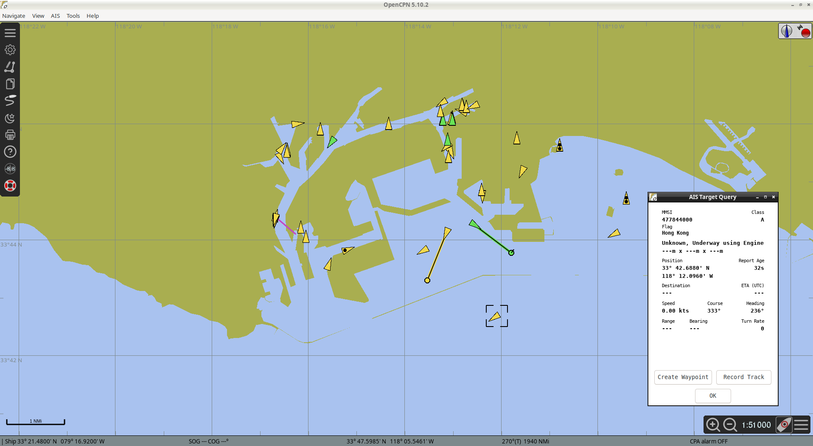

# AIS-Dekoder + OpenCPN: Schiffe live auf der Seekarte (Debian 13)

Anwendungsfall: Der ATmega328-Decoder liefert `!AIVDM`-Sätze am UART; **OpenCPN** zeigt die empfangenen Schiffe auf einer Karte. Die Sätze werden
**unverändert** übernommen – es ist keine Umwandlung nötig. Getestet mit OpenCPN 5.10.2 auf Debian 13 und den Aufnahmen aus `testsignal/`
(abgespielt auf einem echten ATmega328 – Hafen von Los Angeles/Long Beach).



*OpenCPN 5.10.2: Schiffe als Dreiecke mit Kurs-Vektor, Seezeichen/Landstationen als Symbole, Fenster „AIS Target Query" mit MMSI, Flagge (MID 477 = Hongkong), Position, Kurs, Fahrt und Drehrate.*

## Datenweg

```
Scanner-NF ──► ATmega328 (ADC) ──UART 38400 8N1──► /dev/ttyUSB0 ──► cat | nc ──TCP :10110──► OpenCPN
                 !AIVDM-Sätze                       (USB-Seriell)    (oder ser2net)          (AIS-Ziele)
```

OpenCPN kann den seriellen Port auch **direkt** lesen (Verbindungstyp *Seriell*, `/dev/ttyUSB0`, 38400 Baud). Der Weg über TCP ist praktisch, wenn
OpenCPN auf einem anderen Rechner läuft, mehrere Programme mitlesen sollen oder der Port nicht direkt zugänglich ist.

## 1. Voraussetzungen

* Der Decoder gibt NMEA aus (Standard). Der Klartextmodus (`d`) soll **aus** sein – er stört OpenCPN zwar meist nicht, belegt aber die Leitung.
* Benutzerrechte für den Port: `sudo usermod -aG dialout $USER` (danach neu anmelden).
* OpenCPN: `sudo apt install opencpn` (Version mit `apt policy opencpn` prüfen). Für eine nutzbare Karte werden Seekarten benötigt (im Programm über den Chart-Downloader oder OpenCPN-Plugins); die AIS-Anzeige selbst funktioniert auch mit der eingebauten Weltkarte.

## 2. Serieller Port nach TCP

### Schnell (ein Client, zum Ausprobieren)
```
stty -F /dev/ttyUSB0 38400 cs8 -cstopb -parenb raw clocal -echo -hupcl
cat /dev/ttyUSB0 | nc -l 10110
```
* `-hupcl` verhindert, dass das Schließen/Öffnen des Ports bei Arduino-Boards über DTR einen Reset auslöst.
* `nc -l 10110` wartet auf **einen** Client und endet, wenn dieser sich trennt – dann beide Zeilen neu starten (oder `while true; do …; done`).
* Prüfen, ob Daten fließen: in einem zweiten Terminal `nc 127.0.0.1 10110` – es müssen `!AIVDM,…`-Zeilen erscheinen.

Gleichwertig mit `socat`:
```
socat /dev/ttyUSB0,b38400,raw,echo=0 TCP-LISTEN:10110,reuseaddr
```

### Dauerhaft und für mehrere Clients: ser2net
```
sudo apt install ser2net
```
`/etc/ser2net.yaml`:
```
connection: &ais
  accepter: tcp,10110
  enable: on
  connector: serialdev,/dev/ttyUSB0,38400n81,local
```
```
sudo systemctl restart ser2net
sudo systemctl enable ser2net
```
Hinweise: Eine feste Gerätebezeichnung (`/dev/serial/by-id/usb-…`) statt `/dev/ttyUSB0` vermeidet Probleme, wenn mehrere USB-Seriell-Adapter angeschlossen sind.
Die Verbindung ist **unverschlüsselt und ohne Anmeldung** – nur im lokalen Netz anbieten, ggf. per Firewall begrenzen.

## 3. OpenCPN einrichten

1. **Einstellungen** (Zahnrad) → **Verbindungen** → **Verbindung hinzufügen**.
2. **Netzwerk** wählen, Protokoll **TCP**, Adresse `127.0.0.1` (oder die IP des Rechners mit dem Decoder), Port `10110`.
3. Haken bei **Eingang auf diesem Port empfangen**, Prüfsummenkontrolle kann an bleiben (die Sätze tragen die richtige Prüfsumme).
4. Übernehmen. Die Verbindung wird in der Liste angezeigt; die Statusanzeige springt auf „verbunden".
5. Menü **AIS → AIS-Ziele anzeigen** aktivieren, ggf. in den AIS-Einstellungen die Anzeige-Optionen (Kurs-Vektor, Namen, Zielliste) einschalten.
6. Auf ein Schiff klicken → **AIS Target Query** (wie im Bild) mit MMSI, Flagge, Position, Fahrt, Kurs, Heading, Drehrate; Typ-5-Daten (Name, Rufzeichen, Ziel, Abmessungen) kommen nach, sobald das Schiff diese Meldung sendet (alle 6 Minuten).

*(Die Bezeichnungen können je nach Spracheinstellung und Version abweichen; die Reihenfolge ist in 5.10 so.)*

## 4. Wenn nichts erscheint

| Symptom | Ursache / Abhilfe |
|---|---|
| Keine Zeilen bei `cat /dev/ttyUSB0` | Baudrate (38400), Kabel/Adapter, Decoder läuft? Befehl `s` (Statistik) per `make monitor` senden. |
| `Permission denied` | Benutzer nicht in der Gruppe `dialout`. |
| `nc` meldet „Address already in use" | Es läuft noch ein alter `nc`/`ser2net` auf Port 10110: `ss -ltnp | grep 10110`. |
| Verbindung steht, aber keine Schiffe | AIS-Anzeige in OpenCPN aus; Prüfsummenfehler (Zeilen mit `#` oder Klartext dazwischen: `d` ausschalten); Position außerhalb des sichtbaren Kartenausschnitts. |
| Schiffe erscheinen, verschwinden nach Minuten | Normal: OpenCPN blendet Ziele nach der eingestellten Zeit ohne neue Meldung aus. |
| Karte leer / nur Land-Umriss | Kartenmaterial fehlt – AIS-Ziele werden trotzdem gezeichnet. |
| Eigene Position falsch in der Statusleiste | Das ist die „Ship"-Position aus OpenCPN, nicht aus AIS; ohne GPS-Quelle bleibt der letzte Wert stehen. |

## 5. Mitschneiden und Wiedergeben

Zum Aufzeichnen der Sätze: `nc 127.0.0.1 10110 | tee ais.nmea` (nur zur Kontrolle der Daten). Eine solche Datei kann mit
`./host_sim -n ais.nmea` als Klartext angezeigt werden (Test des Textdekoders) oder in OpenCPN über eine zweite Netzwerkverbindung oder ein Datenaufzeichnungs-Plugin wiedergegeben werden.

---
*Dieses Dokument gehört zum AIS-Decoder-Projekt, siehe [README.de.md](README.de.md) / [README.md](README.md).*
