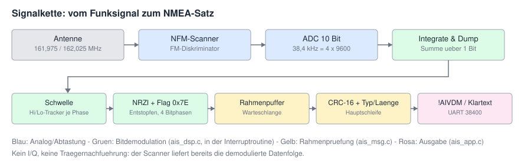
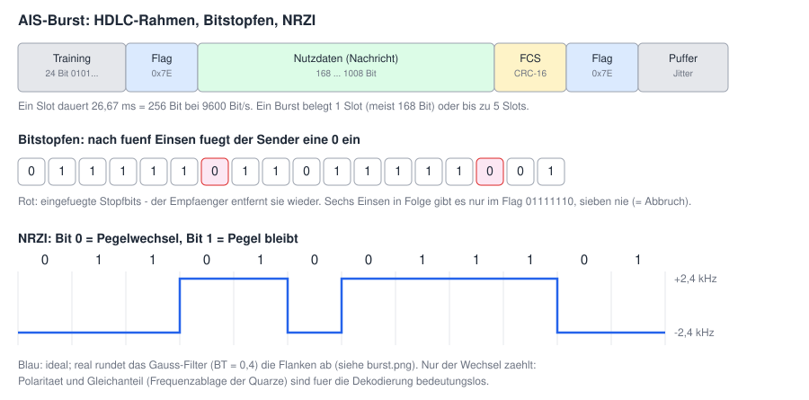
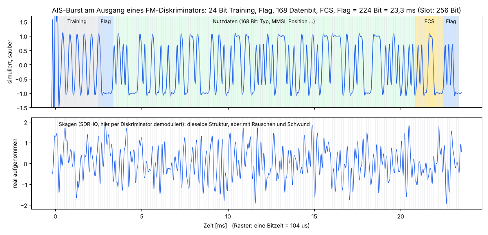
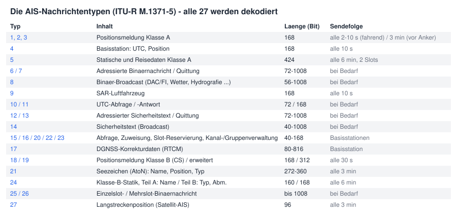
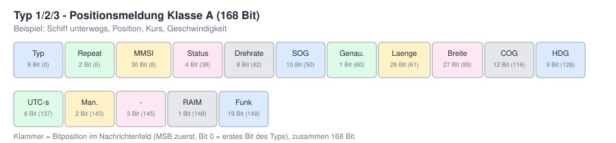
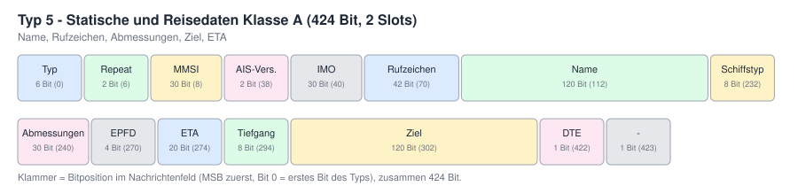
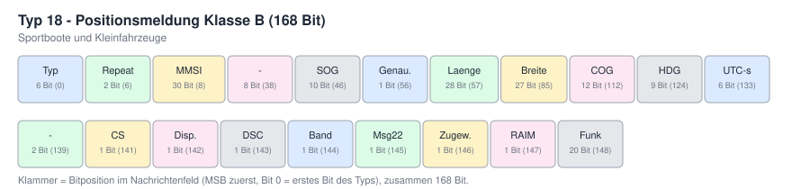
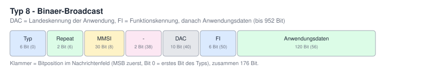
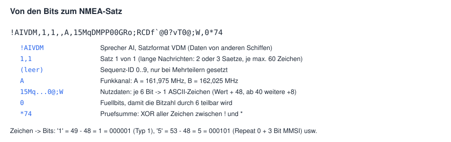

# AIS-Dekoder für ATmega328 (bare metal)

Ein vollständiger **AIS-Empfänger-Decoder** in portablem C: Das NF-Signal eines NFM-Scanners geht direkt an den ADC eines
ATmega328, am UART kommen **`!AIVDM`-NMEA-Sätze** heraus – auf Wunsch zusätzlich jede Nachricht (alle Typen 1–27)
als formatierter Klartext. Kein Arduino-Core, kein Gleitkomma, keine PLL, kein I/Q. Derselbe Kern läuft auf dem PC
(`host_sim`), im AVR-Simulator (simavr) und – unverändert – auf einem ESP32.



*(English version: [README.md](README.md))*

---

## Inhalt
1. [Was ist AIS?](#1-was-ist-ais)
2. [Das Protokoll Schicht für Schicht](#2-das-protokoll-schicht-für-schicht)
3. [Die Nachrichten](#3-die-nachrichten)
4. [NMEA-Ausgabe (`!AIVDM`)](#4-nmea-ausgabe-aivdm)
5. [Der Empfänger: so arbeitet der Code](#5-der-empfänger-so-arbeitet-der-code)
6. [Hardware, Bauen, Bedienen](#6-hardware-bauen-bedienen)
7. [Tests und Ergebnisse](#7-tests-und-ergebnisse)
8. [Bekannte Grenzen](#8-bekannte-grenzen)
9. [Portierung (ESP32 / ESP-IDF)](#9-portierung-esp32--esp-idf)
10. [Dateiübersicht](#10-dateiübersicht)

---

## 1. Was ist AIS?

Das **Automatic Identification System** ist ein Funkverfahren der Seefahrt (IMO/SOLAS, ITU-R M.1371-5): Schiffe senden
automatisch ihre Identität (MMSI), Position, Kurs und Geschwindigkeit; andere Schiffe und Landstationen empfangen das und
sehen so, wer in der Nähe ist – ohne Radar, ohne Sprechfunk. Es gibt zwei Geräteklassen:

| | Klasse A (Berufsschifffahrt) | Klasse B (Sportboote) |
|---|---|---|
| Sendeleistung | 12,5 W | 2 W (CS) / 5 W (SO) |
| Meldeintervall Position | 2–10 s fahrend, 3 min vor Anker | 30 s (3 min bei <2 kn) |
| Statische Daten (Name, Ziel ...) | Typ 5, alle 6 min | Typ 24, alle 6 min |
| Typen | 1, 2, 3, 5, ... | 18, 19, 24 |

Auch **Landstationen** (Basisstationen, Typ 4), **Seezeichen** (AtoN, Typ 21), **Rettungsflugzeuge** (SAR, Typ 9) und
Notsender (AIS-SART, MOB, EPIRB; sie erkennt man an der MMSI) senden AIS.

**Funkparameter:** zwei UKW-Kanäle, **AIS 1 = 161,975 MHz (Kanal 87B, „A")** und **AIS 2 = 162,025 MHz (Kanal 88B, „B")**,
Kanalraster 25 kHz, Reichweite typisch 20–40 Seemeilen. Jeder Kanal ist in **2250 Zeitschlitzen („Slots") pro Minute**
eingeteilt, ein Slot dauert **26,67 ms** (= 256 Bit bei 9600 Bit/s). Die Geräte synchronisieren sich über GNSS-Zeit und
organisieren die Slots selbst (SOTDMA/ITDMA bei Klasse A, CSTDMA bei Klasse B) – kein Master nötig. Ein Empfänger muss deshalb nur
„zuhören" und Bursts erkennen, ohne die Slot-Zeit zu kennen.

---

## 2. Das Protokoll Schicht für Schicht

### 2.1 Bitübertragung: GMSK, 9600 Bit/s
Die Bits schalten die Trägerfrequenz um **±2,4 kHz** um (FSK mit Modulationsindex 0,5). Vorher läuft der Datenstrom durch ein
**Gauß-Filter (BT = 0,4)**: Die Flanken werden verrundet, das Spektrum bleibt schmal (**GMSK**). Der Preis ist eine kleine
**Intersymbol-Interferenz**: Jedes Bit ist etwas vom Nachbarbit beeinflusst. Ein Schmalband-FM-Empfänger (NFM, 25 kHz) liefert
am NF-Ausgang direkt diese Spannung: +2,4 kHz Hub ≙ hoch, −2,4 kHz ≙ tief. Das ist die Eingangsgröße dieses Projekts.

### 2.2 Sicherung: HDLC-Rahmen, Bitstopfen, NRZI, CRC


* **Rahmen:** 24 Bit Trainingsfolge `0101…` (Empfänger einschwingen), Startflag `01111110` (0x7E), Nutzdaten, 16 Bit **FCS**, Endflag.
* **Bitstopfen:** Damit das Flag nirgends in den Daten vorkommt, fügt der Sender nach jeder 5. Eins eine Null ein; der Empfänger entfernt sie.
* **NRZI:** Eine **0** wird als **Pegelwechsel** gesendet, eine **1** als **„Pegel bleibt"**. Es zählt also nur der Wechsel – Polarität und
  Gleichanteil (Frequenzablage der Quarze) sind für den Empfänger unwichtig. Das ist der Grund, warum man hier **keine Trägerverfolgung**
  braucht.
* **CRC-16/X.25:** Polynom 0x1021 (reflektiert 0x8408), Startwert 0xFFFF, Ergebnis invertiert. Über den ganzen Rahmen gerechnet bleibt bei
  fehlerfreiem Empfang der Rest **0xF0B8** übrig. Das ist die einzige Fehlererkennung; deshalb sind die ausgegebenen Sätze „100 % stimmig".
* **Bitreihenfolge (Stolperfalle!):** Auf der Luft geht in jedem Oktett das **niederwertige Bit zuerst** raus (HDLC). Die Datenfelder der
  Nachricht sind aber **MSB-first** angeordnet. Der Decoder speichert die Bits in Luftreihenfolge und liest die Felder mit
  `NMEA-Bit i = Bit (7 − i mod 8) von Byte (i div 8)`.

Hier ein echter Burst im Vergleich zu einem sauberen simulierten (die Struktur ist gut zu sehen: Training als 2,4-kHz-Schwingung, das Flag mit sechs
gleichen Bits als flacher Abschnitt):



### 2.3 Nachrichten
Die Nutzdaten sind eine Bitfolge fester Felder (MSB zuerst). Die ersten 6 Bit sind der **Nachrichtentyp** (1–27), dann 2 Bit Repeat und
die 30-Bit-**MMSI** (9-stellige Schiffskennung; die ersten drei Ziffern sind der Länderkode MID, z. B. 211 = Deutschland, 366 = USA).

---

## 3. Die Nachrichten



**Alle 27 Typen werden dekodiert** – im NMEA-Modus roh weitergereicht, im Klartext-Modus feldweise erklärt. Die Textdekodierung ist
Feld für Feld gegen die unabhängige Python-Bibliothek *pyais* geprüft (siehe [Tests](#7-tests-und-ergebnisse)).

### Typ 1/2/3 – Positionsmeldung Klasse A


Zahlenformate: Breite/Länge in **1/10000 Minute** (÷ 600000 = Grad, vorzeichenbehaftet), SOG in **1/10 kn**, COG in **1/10°**, Drehrate (ROT) als
Wurzel-Kodierung. „Nicht verfügbar"-Werte: Breite 91°, Länge 181°, SOG 1023, COG 3600, HDG 511, ROT −128, UTC-Sekunde 60.

### Typ 5 – Statische und Reisedaten (2 Slots)


Name, Rufzeichen und Ziel sind **6-Bit-ASCII** (0 = `@` = Füllzeichen, 1–31 = `A`…`_`, 32–63 = Leerzeichen…`?`); Abmessungen als Abstände der GNSS-Antenne zu Bug, Heck, Backbord, Steuerbord.

### Typ 18 – Positionsmeldung Klasse B


### Typ 8 – Binär-Broadcast (und 6, 25, 26)


**DAC** (Designated Area Code, im Wesentlichen Länderkennung) und **FI** (Functional ID) bestimmen die Anwendung, z. B. DAC 1 / FI 0 = Text,
DAC 200 / FI 10 = Binnenschifffahrt (Schiffsdaten). Der Decoder zeigt DAC/FI und die Nutzdaten als Hexdump; DAC 1 / FI 0 wird als Text ausgegeben.

---

## 4. NMEA-Ausgabe (`!AIVDM`)



* Eine Nachricht passt in **60 Zeichen pro Satz** (NMEA-Länge max. 82 Zeichen); längere (z. B. Typ 5 mit 424 Bit = 71 Zeichen) werden auf **2–3 Sätze** aufgeteilt, die dieselbe
  **Sequenz-ID (0–9)** tragen, die der Decoder reihum vergibt.
* Kanal `A` oder `B` per Befehl wählbar (Kommando `a` / `b`), der Decoder kennt den Kanal ja nicht aus dem Signal.
* Das Ende `*hh` ist die XOR-Prüfsumme (zwei Hexziffern) aller Zeichen zwischen `!` und `*`.
* Das Format entspricht dem eines Hardware-AIS-Empfängers (NMEA 0183, 38400 Bd) und lässt sich z. B. mit OpenCPN, gpsd oder `pyais` weiterverarbeiten.

Beispiel (Typ 5 in zwei Sätzen, danach Typ 1):
```
!AIVDM,2,1,0,A,55Mw>bP00001L<C;7O4h58<tp62222222222220P1H?624SosFS<4p0CQiC1,0*30
!AIVDM,2,2,0,A,Dp888888888,2*18
!AIVDM,1,1,,A,15MqDMPP00GRo;RCDf`@0?vT0@;W,0*74
```

Dieselben Nachrichten im **Klartext-Debugmodus** (`d`):
```
[A] Pegel 52  Typ 5  Statische und Reisedaten Klasse A
    MMSI 366988970 (MID 366)  Repeat 0  (424 Bit)
    AIS-Version 0  IMO 0  Rufzeichen "WCD2171"
    Name "LARCONA"  Typ 32 Schlepper gross
    Abmessungen Bug 11 Heck 15 Backbord 6 Steuerbord 2 m  EPFD GPS
    ETA 02-07 23:59  Tiefgang 9.0 m
    Ziel "L0S ANGELES"  DTE nicht bereit
[A] Pegel 53  Typ 1  Positionsmeldung Klasse A (planmaessig)
    MMSI 366892150 (MID 366)  Repeat 0  (168 Bit)
    Status 0 unter Maschine  ROT n.v.
    SOG 0.0 kn  COG 0.0°  HDG n.v.
    Pos 33°46.2561'N  118°12.8015'W (grob)
    UTC-Sekunde 18  Manoever n.v.  RAIM nein
    Funk: SOTDMA Sync 0 Timeout 4 Sub 743
```
(„Pegel" ist die mittlere Augenöffnung der empfangenen Bitphase – ein Maß für die Signalqualität; „grob" = Positionsgenauigkeit-Flag 0, also schlechter als 10 m; „genau, DGNSS" = Flag 1.)

---

## 5. Der Empfänger: so arbeitet der Code

Der Kern (`ais_dsp.c`, ca. 100 Zeilen ohne Kommentare) ist erweitert kommentiert. Kurzfassung:

1. **Eingang ist ein Diskriminator, kein I/Q.** Ein NFM-Scanner hat die FM-Demodulation schon erledigt. Deshalb entfällt Mischen, Trägerverfolgung,
   Frequenzablage-Schätzung. (Bei IQ-Aufnahmen rechnet `tools/wav2raw.py --iq` vorher den Diskriminator `Im{z[n]·conj(z[n−1])}`.)
2. **4 Abtastwerte pro Bit (38,4 kHz).** Auf dem ATmega erzeugt Timer1 die Abtastung exakt (Periode 416/417/417 Takte = im Mittel 38,400 kHz) und
   triggert den ADC selbst – kein Jitter durch die ISR. Mit 48 kHz (PC/ESP32) nimmt man `AIS_OSR=5`.
3. **Integrate & Dump:** Die Summe der letzten 4 Werte (genau eine Bitzeit) ist ein Tiefpass und zugleich das optimale Filter für ein Rechteck-Bit.
4. **Schwelle ohne festen Nullpunkt:** Je Bitphase verfolgen zwei Tracker den mittleren Hoch- und Tiefpegel; die Schwelle ist ihre Mitte. Der Gleichanteil
   (Frequenzablage bis ±1 kHz, ADC-Offset) fällt automatisch heraus. Es gibt **keine** angenommenen „512 = Null"; nur der Startwert der Tracker liegt in der ADC-Mitte.
5. **Keine PLL – Phasendiversität:** Die Abtastphase relativ zum Sendertakt ist am Burstanfang unbekannt, und 24 Trainingsbits genügen nicht zum Einrasten. Darum ist
   **jede der 4 Abtastphasen ein vollständiger Empfänger** (Entscheidung, NRZI, Flagsuche, Entstopfen, Rahmenpuffer). Pro Abtastwert rechnet nur einer – die Last ist die eines
   einzelnen. Die Phasen nahe am idealen Zeitpunkt liefern einen fehlerfreien Rahmen, die anderen Müll (CRC falsch, verworfen). Doppelte Treffer werden in `ais_app.c`
   über Länge, FCS und Zeitabstand erkannt.
6. **Interruptroutine kurz:** Die ISR schiebt nur Bits in Rahmenpuffer. CRC, NMEA und Text rechnet die Hauptschleife.
7. **Plausibilitätsprüfung (`AIS_STRICT`):** Typ 1–27 und Längentabelle nach M.1371-5; unbekannte Typen und unzulässige Längen werden verworfen, auch bei richtiger CRC.

Ressourcen (avr-gcc, `-Os`, `-flto`): Flash **17,6 kB** (54 %), RAM **954 Byte** (47 %); die ISR braucht im Simulator im Mittel **199**, maximal **363 von 416 Takten**
(Last 48 %). Die Hauptschleife (CRC, UART-Ausgabe) läuft parallel dazu, weil die ISR weiterläuft.

---

## 6. Hardware, Bauen, Bedienen

**Eingangsbeschaltung** (NF-Ausgang direkt hinter dem FM-Diskriminator, nicht der Lautsprecher mit Sprachfilter!):
```
                      Vcc
                       |
                      [10k]
   NF ----||----+------+------[1k]------+---- ADC0 (A0)
       100 nF   |                       |
               [10k]                  [22n]
                |                       |
               GND                     GND
```
Vorspannung auf Vcc/2, Anti-Alias-Tiefpass ca. 7 kHz. Der AIS-Hub (±2,4 kHz) sollte am ADC mindestens ca. ±50 LSB ausmachen, ohne anzustoßen.
Die Abtastrate 38,4 kHz = 4 × 9600 erzeugt Timer1 aus dem 16-MHz-Quarz. UART: **38400 8N1**. LED an PB5 blinkt bei gültiger Nachricht.

**Bauen**
```
make                       # Firmware main.hex (avr-gcc), make flash zum Programmieren (avrdude)
make host_sim OSR=4        # PC-Version:  ./host_sim datei.raw [-t Klartext] [-b Kanal B] [-q ohne Statistik]
make raw WAV=aufnahme.wav RAW=x.raw [IQ=--iq]
make testall               # Gesamttest, schreibt testsignal/testergebnis.txt
make simload RAW=x.raw SECS=20   # echte Firmware in simavr, mit Lastmessung
make monitor               # serielles Terminal mit Eingabe (picocom/screen), make cmd C=d sendet ein Zeichen
make monitor_ro            # Nur lesen (kann nichts senden)
```
**Befehle über den UART** (ein Zeichen): `n` NMEA ein/aus · `d` Klartext ein/aus · `a`/`b` Kanal · `s` Statistik · `?` Hilfe.

---

## 7. Tests und Ergebnisse

`make testall` (`tools/test_all.py`) fasst alles zusammen (Ergebnis: [testsignal/testergebnis.txt](testsignal/testergebnis.txt)):

| Fall | Soll | Erkannt | Bemerkung |
|---|---:|---:|---|
| Skagen, IQ-Aufnahme (OSR 4 und 5) | 13 | 13 / 13 | unabhängiger Referenzdecoder (Python) |
| Algarve, NF-Aufnahme | 8 | 8 / 8 | + 2 weitere CRC-gültige Nachrichten |
| Los Angeles Test 1 (8 Bit, 48 kHz) | 77 | 71 / 74 | Regressionsreferenz (OSR 4 / 5) |
| Los Angeles Test 2 (16 Bit, 48 kHz) | 112 | 109 / 111 | 5 Typen (1, 3, 5, 10, 11), darunter Typ 5 mit 2 Sätzen; alle 105 Nachrichten der OSR-4-Referenz sind von pyais dekodierbar |
| synthetisch, sauber (60 Nachrichten, alle Typen) | 61 | 60 | |
| synthetisch, Schwund 12 dB / ±50 ppm / HP 30 Hz / DC 800 Hz | 61 | 58–60 | |
| synthetisch, 14 dB SNR | 61 | 27–29 | Rauschgrenze |
| Textdekoder, alle Typen 1–27 | 1187 Feldprüfungen | 0 Abweichungen | gegen *pyais* |

Weitere Werkzeuge: `tools/gen_ais.py` (bitgenauer Testsignal-Generator, alle Typen, GMSK, Rauschen, Schwund, Gleichanteil, Hochpass),
`tools/ref_decoder.py` (unabhängiger Gleitkomma-Dekoder in Python), `tools/compare.py`, `tools/test_text.py`, `tools/avr_sim.c`
(simavr-Rahmen für die echte Firmware), `tools/make_doc.py` (erzeugt die Grafiken in `doc/`).

---

## 8. Bekannte Grenzen

* **Sprachkanal-Audio geht nicht.** Ist das Audio auf 300–3700 Hz gefiltert (z. B. WebSDR im NFM-Modus, MP3-Aufnahmen, Lautsprecherausgang
  vieler Scanner), fehlen die Anteile, die die 9600 Bit/s tragen; ein Hochpass bei 300 Hz lässt lange Gleichpegel-Folgen „durchhängen". In der Simulation
  dieses Frequenzgangs: 0 von 43 Nachrichten. Abhilfe: **Diskriminatorausgang** abgreifen oder **IQ aufnehmen** und `wav2raw.py --iq` verwenden.
* **Gleichanteil:** Frequenzablagen bis etwa ±1,5 kHz werden aufgefangen; mehr verschlechtert den Empfang.
* **Rauschen:** Unter ca. 15 dB SNR bricht die Rate stark ein (siehe Tabelle); Fehler werden aber immer durch die CRC verworfen, nie falsch ausgegeben.
* **Slot-Kollisionen:** Zwei gleichzeitige Bursts sind nicht trennbar; es gibt keinen Mehrfachempfang.
* Hardware-Test: Die Aufnahmen wurden auf einem echten ATmega328 abgespielt (Wiedergabe an den ADC, Timer1-Auto-Trigger, ISR, UART) und dekodiert; der simavr-Lauf (Ersatzvariante `-DAIS_SIM`) dient nur der Lastmessung und als Regressionstest. 

---

## 9. Portierung (ESP32 / ESP-IDF)

Für diese Aufgabe eigentlich nicht nötig – der ATmega328 reicht (und ist zu 54 % ausgelastet). Der Kern ist aber plattformneutral: `ais_dsp.c`, `ais_msg.c`, `ais_app.c` kennen weder ADC noch UART.
Für den ESP32 (ESP-IDF 6.1) ersetzt man nur `main.c`: ADC/I²S mit 48 kHz abtasten, jeden 10-Bit-Wert (12 Bit → `>> 2`) an `ais_dsp_sample()` übergeben,
`ais_app_poll()` aus einer Task aufrufen und `ais_putc()` auf `uart_write_bytes()` legen; Kompilieren mit `-DAIS_OSR=5`. Der Flash-Zugriff (`AIS_ROM`) ist auf Nicht-AVR ein normaler Speicherzugriff.

---

## 10. Dateiübersicht

| Datei | Inhalt |
|---|---|
| `ais_port.h` | Portabilitätsschicht (PROGMEM, `ais_putc`) |
| `ais_dsp.c/.h` | Empfangskern: Integrate&Dump, Schwelle, NRZI, Flag, Entstopfen, Rahmenpuffer (ISR-tauglich) |
| `ais_msg.c/.h` | CRC, Typ-/Längenprüfung, NMEA-Ausgabe, Klartext aller Typen |
| `ais_app.c/.h` | Hauptschleife: Rahmen prüfen, Duplikate entfernen, ausgeben, Kommandos, Statistik |
| `main.c` | ATmega328P: Timer1/ADC-Abtastung, UART, LED |
| `host_sim.c` | PC-Testrahmen (Rohdatei → Dekoder), NMEA→Klartext-Modus |
| `Makefile` | Firmware, PC-Simulation, Tests, simavr |
| `tools/` | Generator, Referenzdecoder, Testskripte, Grafik-Erzeugung |
| `testsignal/` | Aufnahmen, Referenzen, dekodierte Ausgaben, Testergebnis |
| `doc/` | Grafiken für diese README |

*Quellen: ITU-R M.1371-5 (technische Merkmale AIS), IEC 61162-1 / NMEA 0183 (`!AIVDM`), IEC 62287 (Klasse B CS).*
